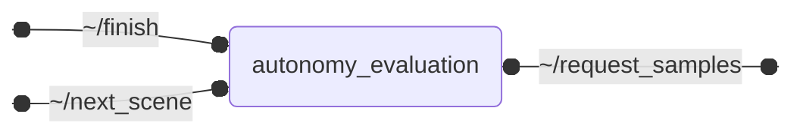

# `autonomy_evaluation`

Metrics-based evaluation of automated driving modules, generating the evidence for benchmarking automated driving deployments

`autonomy_evaluation` is the part of the **Autonomy.Benchmarks** suite that turns the output of a system under test into
metrics. It evaluates the samples that [autonomy_datasets](https://github.com/thinking-cars/autonomy_datasets) replays
against the labels of the dataset, and reports the metrics per scene and over all evaluated samples, as one part of the evidence
an automated driving deployment is benchmarked on.

## Nodes

### `autonomy_evaluation`

The node runs the evaluations selected by `evaluation`: an evaluation of this package by its name, each belonging to an area of automated driving (`area` of the results), i.e. `object_detection_3d` of the perception, `trajectory_deviation` of the planning, and `criticality`, `rule_compliance`, `progress` and `comfort` of the driving behavior; all evaluations of an area by the name of the area, e.g. `driving_behavior`; an evaluation implemented in another package as `<module>:<class>` (see [Adding more Evaluations](../docs/IMPLEMENTATION.md#adding-more-evaluations)); or several of them as comma-separated list, e.g. `criticality,comfort`. The evaluations of a node are evaluated on the same samples and read an input of the same name from the same topic; each keeps its own configuration and results. An evaluation is composed of metrics, of which its configuration selects those it computes. Each metric declares the topics it reads, each in a role: _evaluated_, i.e. the output or behavior of the system under test, _reference_, i.e. the ground truth the evaluated topics are compared with, or _context_, i.e. what a metric needs without evaluating or comparing it, e.g. the road users the ego vehicle interacts with. The node subscribes to the topics of the computed metrics, each on its node-relative name, which the launch file remaps onto the topic given by the launch argument of the same name, e.g. `prediction:=/object_list/prediction`. A topic without such an argument is subscribed in the private namespace of the node. The node logs each topic it reads with its role. A topic a metric declares as optional, e.g. meta information that not every dataset publishes, is only waited for while it has a publisher; otherwise, the samples are evaluated without it. A topic a metric reads by its latest message, e.g. a route planned independently of the samples, is not matched by its stamp: every sample is passed its latest message.

| Area | Evaluation | Evaluated | Reference | Context |
| --- | --- | --- | --- | --- |
| perception | `object_detection_3d` | `prediction` (`perception_msgs/ObjectList`) | `label` (`perception_msgs/ObjectList`); optionally `label_meta_info` (`autonomy_datasets_msgs/ObjectListMetaInfo`, subscribed next to `label` on `<label topic>/meta_info`) | - |
| planning | `trajectory_deviation` | `evaluated` (`perception_msgs/EgoData`, its planned or driven trajectory, or `trajectory_planning_msgs/Trajectory`) | `reference` (`perception_msgs/EgoData`, its planned or driven trajectory, or `trajectory_planning_msgs/Trajectory`); both may be the same topic, e.g. to compare the driven with the planned trajectory | - |
| driving_behavior | `criticality`, `rule_compliance`, `progress`, `comfort` | `ego_data` (`perception_msgs/EgoData`) | - | `objects` (`perception_msgs/ObjectList`), read by `criticality` only; optionally the latest `route` (`route_planning_msgs/Route`), read by `progress`; optionally the Lanelet2 `map` of the current scene from the parameters of the `map_server`, read by `criticality` and needed by `rule_compliance` |

A metric may also use the Lanelet2 map of the current scene, e.g. to find the lane the ego vehicle drives in. The node reads the map from the parameters `map_contents`, `origin_lat`, `origin_lon` and `map_frame_id` of the node set as `map_server`, as [lanelet2_map_server](https://github.com/openads-project/lanelet2_map_server) and [autonomy_datasets](https://github.com/thinking-cars/autonomy_datasets) (`/datasets`) provide them, and loads it anew whenever they change, e.g. with each scene of a dataset.

Each evaluation is configured by parameters named `<evaluation>.<entry>`, e.g. `object_detection_3d.metrics` selecting the metrics it computes, which are usually set in a parameter file passed via the `config` launch argument. Nested entries are nested in the parameter file. Every entry that is not set keeps its default; the entries of each evaluation are documented in [IMPLEMENTATION.md](../docs/IMPLEMENTATION.md), their general structure in [Configuration](../docs/IMPLEMENTATION.md#configuration). Optional limits on the metrics, e.g. `criticality.limits: ["collision.at_fault == 0"]`, judge the results as passed or failed (see [Limits](../docs/IMPLEMENTATION.md#limits)); without limits, the results hold no verdict.

```yaml
/**:
  ros__parameters:
    object_detection_3d:
      metrics: [ap, ate]  # compute and report the average precision and the translation error only
      ap:
        matching_thresholds: [1.0, 2.0]
```

The messages of all topics that belong to the same sample are matched by their stamp and evaluated together. By default, only messages with exactly the same stamp are matched, as the dataset stamps all messages of a sample with its recording time and a system under test stamps its output with the stamp of the input it processed. Set `sync_tolerance` to match topics whose stamps differ, e.g. those a simulation publishes at slightly different times or at different rates. A message without a header, e.g. a `std_msgs/Bool`, is stamped with the time it is received at.

With `sample_source` set to `dataset`, the default, the node requests the samples it evaluates from the dataset, using the `request_samples` service of [autonomy_datasets](https://github.com/thinking-cars/autonomy_datasets), which publishes them and responds once they have been published. By default one sample is requested at a time, so the dataset only publishes the next sample once the system under test has delivered its output for the current one and the node has evaluated it. Increase `samples_per_request` to publish samples in batches, set it to `0` to publish the whole dataset with a single request, or list the IDs of individual samples in `sample_ids` to evaluate only those.

Once the dataset reports that all requested samples have been published, or its node has shut down after publishing its last sample, the per-sample metrics are aggregated over all evaluated samples (`metrics`) and for the samples of each scene the dataset published them from (`scenes`, matched with the samples via the `published_scene_ids` of the responses). The metrics of each evaluation are logged, and written to a JSON file if `results_path` is set, in which `{evaluation}` is replaced by the name of the evaluation, as required to run several, together with the topics that were read and their roles (`inputs`), the configuration of the evaluation (`config`), and how regularly the samples were evaluated, including gaps of missing samples (`sampling`, see [Sequences of samples](../docs/IMPLEMENTATION.md#sequences-of-samples)), and, if limits are configured, whether the metrics pass them (`limits`). Samples that are not evaluated within `evaluation_timeout` seconds of being published, e.g. because the system under test skipped them, are left out.

```bash
ros2 launch autonomy_evaluation autonomy_evaluation.launch.py \
  prediction:=/object_list/prediction \
  label:=/object_list/lidar_01 \
  request_samples:=/datasets/request_samples \
  config:=/config/object_detection_3d.yml \
  results_path:=/results/object_detection_3d.json
```

With `sample_source` set to `external`, the node requests no samples itself and evaluates every sample that others publish, e.g. a closed-loop simulation, a live system, or the dataset stepped through with the [playback panel](https://github.com/thinking-cars/autonomy_datasets/blob/main/autonomy_datasets_rviz_plugins/README.md) in RViz, whose _Service_ field has to name the `request_samples` service of the dataset node (`/datasets/request_samples` by default). `samples_per_request`, `sample_ids` and `evaluation_timeout` then have no effect. As the node receives no responses of a dataset, whoever publishes the samples has to tell it about their scenes and the end of publishing. It separates the samples into scenes by calling the `~/next_scene` service, e.g. a closed-loop simulation between two scenarios: once it has been called, the samples evaluated between two calls form a scene of their own, named `scene_1`, `scene_2`, … in the order they were evaluated, and scenes without samples are skipped, so it may be called before or after every scenario alike; without any call, `scenes` stays empty. The results of the evaluated samples are reported once whoever publishes the samples calls the `~/finish` service, e.g. a closed-loop simulation after its last scenario, or once the node is stopped, e.g. with Ctrl-C, which marks them as incomplete, unless `shutdown_completes` is set, e.g. when an orchestration stops the evaluation together with the simulation at the end of each scenario. A sample the evaluation cannot evaluate, e.g. without the transform between its frames right after a simulation started, is skipped with a warning, counted in `num_skipped_samples` of the results.

```bash
# look at the samples of a dataset one by one, stepping through them in RViz
ros2 launch autonomy_evaluation autonomy_evaluation.launch.py \
  prediction:=/object_list/prediction \
  label:=/object_list/lidar_01 \
  visualize:=true \
  sample_source:=external

# evaluate the driving behavior, i.e. criticality, rule compliance, progress and comfort, in a running closed-loop
# simulation, which calls '~/next_scene' between its scenarios and '~/finish' after the last one; writes criticality.json etc.
ros2 launch autonomy_evaluation autonomy_evaluation.launch.py \
  evaluation:=driving_behavior \
  ego_data:=/simulation/ego_data \
  objects:=/simulation/objects \
  map_server:=/lanelet2_map_server \
  sample_source:=external \
  sync_tolerance:=0.05 \
  results_path:='/results/{evaluation}.json'

# evaluate the criticality and the comfort only
ros2 launch autonomy_evaluation autonomy_evaluation.launch.py \
  evaluation:=criticality,comfort \
  ego_data:=/simulation/ego_data \
  objects:=/simulation/objects \
  sample_source:=external \
  results_path:='/results/{evaluation}.json'

# run an evaluation of another package
ros2 launch autonomy_evaluation autonomy_evaluation.launch.py \
  evaluation:=my_package.evaluations:MyPlannerEvaluation \
  ego_data:=/simulation/ego_data \
  objects:=/simulation/objects \
  sample_source:=external
```



#### Service Servers

| Service | Type | Description |
| --- | --- | --- |
| `~/finish` | `std_srvs/srv/Trigger` | finish the evaluation: report its results and shut down; the results are complete with sample source `external`, and with sample source `dataset` once the dataset has published its last sample |
| `~/next_scene` | `std_srvs/srv/Trigger` | start the next scene with sample source `external`: the samples evaluated since the previous call form a scene of their own, e.g. a scenario of a closed-loop simulation |

#### Service Clients

| Service | Type | Description |
| --- | --- | --- |
| `~/request_samples` | `autonomy_datasets_msgs/srv/RequestSamples` | request samples from dataset |

#### Parameters

| Parameter | Type | Default | Description |
| --- | --- | --- | --- |
| `evaluation` | `string` | `object_detection_3d` | evaluations to run on the same samples: the name of an evaluation of this package, of an area running all its evaluations, e.g. 'driving_behavior', or '<module>:<class>' of an evaluation implemented in another package; several as comma-separated list, e.g. 'criticality,comfort' |
| `visualize` | `bool` | `false` | publish the per-sample visualization of the evaluation for RViz, e.g. the true positives, false positives and false negatives of an object detection |
| `sample_source` | `string` | `dataset` | 'dataset' requests the samples to evaluate from the dataset one after another; 'external' evaluates the samples published by others, e.g. by a simulation, a live system or the playback panel in RViz, and reports the results once the node is stopped |
| `shutdown_completes` | `bool` | `false` | with sample source 'external', mark the results written when the node is stopped as complete, e.g. when an orchestration stops the evaluation together with the simulation at the end of each scenario |
| `sync_tolerance` | `float` | `0.0` | seconds by which the stamps of the messages of a sample may differ; 0 only matches messages with exactly the same stamp, as the dataset and a system under test echoing its stamps publish them |
| `samples_per_request` | `int` | `1` | number of samples to request from the dataset at a time; 0 requests all remaining samples at once, 1 evaluates every sample before the next one is published |
| `sample_ids` | `string` | - | comma-separated IDs of the dataset samples to evaluate (e.g. '0,10,20'); if empty, all samples of the dataset are evaluated |
| `evaluation_timeout` | `float` | `60.0` | seconds to wait for a published sample to be evaluated before continuing without it |
| `results_path` | `string` | - | path of the JSON file the results of an evaluation are written to, in which '{evaluation}' is replaced by the name of the evaluation, as required to run several; results are only logged if empty |
| `map_server` | `string` | - | node providing the Lanelet2 map of the current scene by its parameters 'map_contents', 'origin_lat', 'origin_lon' and 'map_frame_id', e.g. '/datasets' of autonomy_datasets or '/lanelet2_map_server'; evaluated without map if empty |

## Launch Files

### [`autonomy_evaluation.launch.py`](launch/autonomy_evaluation.launch.py)

| Argument | Default | Description |
| --- | --- | --- |
| `request_samples` | `"~/request_samples"` | service of the dataset node used to request the samples to evaluate |
| `next_scene` | `"~/next_scene"` | service starting the next scene of the samples published by others, e.g. called by a closed-loop simulation between two scenarios |
| `finish` | `"~/finish"` | service finishing the evaluation, e.g. called by a closed-loop simulation after its last scenario |
| `evaluation` | `"object_detection_3d"` | evaluations to run: an evaluation, an area running all its evaluations, or a comma-separated list of both, e.g. `criticality,comfort` |
| `config` | `""` | path of a ROS parameter file configuring the evaluations by parameters named `<evaluation>.<entry>` (default configuration if empty) |
| `name` | `"autonomy_evaluation"` | node name |
| `namespace` | `""` | node namespace |
| `log_level` | `"info"` | ros logging level |
| `use_sim_time` | `"true"` | use sim time |
| `visualize` | `"false"` | publish the per-sample visualization of the evaluations and open RViz on it, with the first of `config/<selection>.rviz`, `config/<evaluation>.rviz` and `config/<area>.rviz` the package has, e.g. `driving_behavior.rviz`, and `config/conf.rviz` otherwise |
| `sample_source` | `"dataset"` | 'dataset' requests the samples to evaluate from the dataset one after another; 'external' evaluates the samples published by others, e.g. by a simulation or the playback panel in RViz |
| `shutdown_completes` | `"false"` | with sample source 'external', mark the results written when the node is stopped as complete, e.g. when an orchestration stops the evaluation together with the simulation at the end of each scenario |
| `sync_tolerance` | `"0.0"` | seconds by which the stamps of the messages of a sample may differ (0 matches exact stamps only) |
| `samples_per_request` | `"1"` | number of samples to request from the dataset at a time (0 requests all remaining samples at once) |
| `sample_ids` | `""` | comma-separated IDs of the dataset samples to evaluate (all samples if empty) |
| `evaluation_timeout` | `"60.0"` | seconds to wait for a published sample to be evaluated before continuing without it |
| `map_server` | `""` | node providing the Lanelet2 map of the current scene by its parameters, e.g. `/datasets` of autonomy_datasets (evaluated without map if empty) |
| `results_path` | `""` | path of the JSON file the results of an evaluation are written to, in which `{evaluation}` is replaced by the name of the evaluation, as required to run several (results are only logged if empty) |
