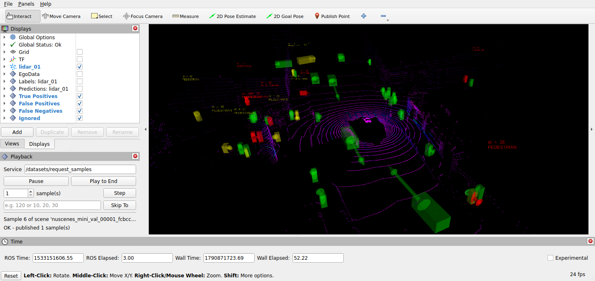

# Implementation Details

This repository supports the following evaluations of automated driving systems:

- [3D Object Detection](#3d-object-detection): 3D bounding-box object detection on the classes of `perception_msgs/ObjectClassification`
- [Closed-Loop](#closed-loop): driving behavior of the ego vehicle a system under test drives in closed loop, e.g. in a simulation

### 3D Object Detection



Evaluates 3D bounding boxes, e.g. detected in lidar point clouds, camera images or both, against the labels of a dataset. Predictions and labels are compared on the classes of [`perception_msgs/ObjectClassification`](https://github.com/ika-rwth-aachen/perception_interfaces/blob/main/perception_msgs/msg/ObjectClassification.msg), so a model can be evaluated on datasets of different class taxonomies. The metrics follow the [nuScenes detection benchmark](https://www.nuscenes.org/object-detection), which serves as reference; the evaluation is no implementation of the official nuScenes challenge and deviates from it as listed [below](#deviations-from-the-nuscenes-reference).

**Supported datasets:** every dataset of [autonomy_datasets](https://github.com/thinking-cars/autonomy_datasets) that publishes 3D object labels:

- [Waymo Open Dataset](https://github.com/thinking-cars/autonomy_datasets/blob/main/docs/IMPLEMENTATION.md#waymo-open-dataset)
- [nuScenes](https://github.com/thinking-cars/autonomy_datasets/blob/main/docs/IMPLEMENTATION.md#nuscenes-dataset)
- [MAN TruckScenes](https://github.com/thinking-cars/autonomy_datasets/blob/main/docs/IMPLEMENTATION.md#man-truckscenes-dataset)
- [NVIDIA PhysicalAI AV Dataset](https://github.com/thinking-cars/autonomy_datasets/blob/main/docs/IMPLEMENTATION.md#nvidia-physicalai-av-dataset)
- [DrivIng](https://github.com/thinking-cars/autonomy_datasets/blob/main/docs/IMPLEMENTATION.md#driving-dataset)
- [TUM Traffic](https://github.com/thinking-cars/autonomy_datasets/blob/main/docs/IMPLEMENTATION.md#tum-traffic-dataset)
- [Zenseact Open Dataset](https://github.com/thinking-cars/autonomy_datasets/blob/main/docs/IMPLEMENTATION.md#zenseact-open-dataset)
- [FZI-AURA](https://github.com/thinking-cars/autonomy_datasets/blob/main/docs/IMPLEMENTATION.md#fzi-aura-dataset)

| Topic | Type | Description |
| --- | --- | --- |
| `prediction` | `perception_msgs/ObjectList` | 3D objects detected by the system under test |
| `label` | `perception_msgs/ObjectList` | 3D object labels of the dataset; predictions in another frame are transformed into the frame of the labels with the transforms published on `/tf` and `/tf_static` |
| `label_meta_info` (optional) | `autonomy_datasets_msgs/ObjectListMetaInfo` | dataset annotations of the labels, subscribed next to `label` on `<label topic>/meta_info`; only read to recognize bike racks. Samples of a dataset that publishes no meta information are evaluated without it |

Metrics are computed based on the following assumptions:

- **Classes**: the evaluated classes are the classes of `perception_msgs/ObjectClassification`: `pedestrian`, `bicycle`, `motorcycle`, `car`, `utility`, `bus`, `animal`, `vru` and `micro`.
  - The classes of an object are the classes of its classifications that share the highest probability. A dataset that cannot tell which class an object has assigns all its possible classes with the same probability, e.g. Waymo a vehicle as `car`, `motorcycle`, `utility`, `bus` and `micro`. A detection usually has a single most probable class.
  - classes the message does not define, e.g. Waymo's signs, are evaluated as `UNKNOWN`.
  - `UNKNOWN` (definitely none of the defined classes) and `UNCLASSIFIED` (unknown classification, i.e. any class) are never evaluated. Predictions of neither evaluated class, e.g. barriers and traffic cones of a nuScenes-trained detector, are dropped.
- **Compatibility**: a prediction may only match a label if all its classes are possible classes of the label, e.g. a `utility` prediction matches a Waymo vehicle but not a nuScenes car. An `UNCLASSIFIED` label may be any class.
- **Positive and don't-care labels**: a label whose possible classes are all evaluated counts exactly once, as true positive or false negative. A label that may also be `UNKNOWN` or `UNCLASSIFIED` is a don't-care object: a prediction matched to it is ignored, and it is never a false negative. A label that can only be `UNKNOWN`, e.g. a nuScenes barrier, is matched by no prediction, so a `car` predicted on it is a false positive.
- **Evaluated classes**: classes that the labels of a dataset do not distinguish are evaluated together, as one class named after its members joined by `|`. All possible classes of a positive label end up in the same evaluated class, and the evaluated classes are derived from the labels of all evaluated samples, so the results of each scene use the same classes as the results of all samples. Each label and each detection of a single class therefore counts for exactly one evaluated class.

  <details>
  <summary>Evaluated classes per dataset</summary>

  | Dataset | Evaluated classes |
  | --- | --- |
  | nuScenes, MAN TruckScenes, Zenseact Open Dataset, FZI-AURA, DrivIng, TUM Traffic | one per class, e.g. `car`, `utility` (trucks, trailers, construction and emergency vehicles), `bus`, `pedestrian`, `bicycle`, `motorcycle`, `vru` (strollers, wheelchairs), `micro` (personal mobility), `animal` |
  | Waymo Open Dataset | `motorcycle\|car\|utility\|bus\|micro` (vehicles), `pedestrian\|vru` (pedestrians), `bicycle` (cyclists); its unknown objects, labeled `UNKNOWN` or `ANIMAL`, are don't-care |
  | NVIDIA PhysicalAI AV Dataset | `car`, `utility`, `bus`, `pedestrian\|vru` (persons and strollers), `bicycle\|motorcycle` (riders), `animal`; its other vehicles, labeled `UNKNOWN` or `MOTORCYCLE`, are don't-care |

  Objects that Zenseact Open Dataset flags as unclear and FZI-AURA objects of unknown categories are `UNCLASSIFIED`, hence don't-care. A dataset should only list several possible classes for objects whose class it systematically cannot tell, since a single such label joins its classes for the whole evaluation.

  </details>

- **Matching**: predictions, highest confidence first, each claim the nearest unclaimed compatible label whose 2D center distance on the ground plane is below the threshold of `{0.5, 1.0, 2.0, 4.0} meters`; of equally distant labels, positive ones are claimed first. For labels of a single class, this is the per-class matching of nuScenes. A true positive belongs to the evaluated class of its label, a false positive counts against the evaluated class of each of its classes.
- **Detection range**: labels and predictions are only considered within the range of their classes. An object of several possible classes uses the largest of their ranges, an `UNCLASSIFIED` label the largest of all.

  <details>
  <summary>Per-class detection range</summary>

  - Car, Utility, Bus: `< 50 m`
  - Pedestrian, Bicycle, Motorcycle: `< 40 m`
  - VRU, Micro, Animal: `< 40 m` (not evaluated by nuScenes, ranged like pedestrians)

  </details>

- **Bike racks**: bicycles and motorcycles are removed from predictions and labels if their center falls inside the footprint of a bike rack. Bike racks are recognized by their `original_class` (`static_object.bicycle_rack`) in the optional label meta information, as published for nuScenes and MAN TruckScenes.
- **Average precision**: for each match threshold, the average precision (`ap`) is calculated by integrating the recall-precision curve for recalls **and** precisions `> 0.1` (points at or below either threshold are excluded). The mean average precision (mAP) is the average over match thresholds and evaluated classes with labels; an evaluated class without labels has no AP, so its predictions do not dilute the mAP. Evaluated classes with labels that the model never predicts count with AP 0.
- **True positive metrics** (`ate`, ...) are calculated using a match threshold of `2.0 m`. The velocity error `ave` is only computed against labels whose velocity is set: `perception_msgs` marks a state entry that is not set with `CONTINUOUS_STATE_COVARIANCE_INVALID` on the diagonal of the state covariance. Without any label with velocity, `ave` is unavailable.
- **Detection score**: `(5·mAP + Σ max(1−m{metric},0)) / (5 + number of TP metrics)` over the available TP metrics `ate`, `ase`, `aoe` and `ave`, i.e. the formula of the nuScenes detection score (NDS) without the attribute error.

#### Deviations from the nuScenes reference

- **Classes**: the classes of `perception_msgs/ObjectClassification` replace the 10 nuScenes detection classes, e.g. trucks, trailers and construction vehicles are evaluated together as `utility`, barriers and traffic cones are not evaluated, and strollers, wheelchairs, personal mobility devices, animals and emergency vehicles are. Classes without labels in the evaluated samples are skipped instead of entering the mean with AP 0.
- **Attributes**: `perception_msgs/Object` cannot carry attributes, so the attribute error `aae` is not evaluated and the detection score is not comparable to the official NDS.
- **Velocities**: as nuScenes skips labels whose velocity cannot be determined, the velocity error skips labels whose velocity is not marked as set in their state covariance. Without any such label, `ave` is left out of the detection score instead of counting as error 1.
- **Label filters**: the evaluation does not filter labels by their number of points. autonomy_datasets publishes lidar labels with at least `min_lidar_points_in_bbox` lidar points (default `1`), so labels that only radar points fall into are missing. Bike racks are only known if their labels are published, and their footprint is checked in 2D.
- **Ranges** are measured from the origin of the frame the labels are given in, e.g. the lidar, instead of the ego vehicle.
- **TP errors** are interpolated over the recall of all predictions instead of over their confidence.
- The number of predictions per sample is not limited.

#### Configuration

The evaluation is configured by the entries below (see [Configuration](#configuration)), e.g. in a parameter file passed via the `config` launch argument. All metrics are selected by default; a selected `detection_score` computes the AP and TP errors it combines, but only reports them if they are selected themselves.

| Entry | Default | Description |
| --- | --- | --- |
| `metrics` | `[num_labels, num_predictions, ap, ate, ase, aoe, ave, detection_score]` | selected metrics, see the output metrics below |
| `class_ranges.{class}` | `40.0`, `50.0` for `car`, `utility`, `bus` | maximum distance in meters from the origin of the label frame up to which objects of the class are evaluated |
| `bike_rack_filtered_classes` | `[bicycle, motorcycle]` | classes removed inside the footprint of a bike rack |
| `tp_metric_threshold` | `2.0` | match threshold in meters of the TP errors and the visualization |
| `min_recall` | `0.1` | recall at or below which P-R points are excluded from the AP and TP errors are not averaged |
| `ap.matching_thresholds` | `[0.5, 1.0, 2.0, 4.0]` | match thresholds in meters the AP is computed at |
| `ap.min_precision` | `0.1` | precision at or below which P-R points are excluded from the AP |
| `detection_score.map_weight` | `5.0` | weight of the mAP relative to each TP error in the detection score |
| `max_sample_interval` | `1.0` | seconds between two consecutive samples beyond which they belong to different sequences |

```yaml
/**:
  ros__parameters:
    object_detection_3d:
      metrics: [ap, ate]  # compute and report the average precision and the translation error only
      ap:
        matching_thresholds: [1.0, 2.0]
```

<details>
<summary>Output metrics</summary>

The results hold the `metrics` over all evaluated samples and, under `scenes`, the `num_samples`, `sample_ids` and `metrics` of each scene. Each metric holds its aggregated value under `_value_`, next to its sub-metrics per match threshold or per evaluated class `{class}`, e.g. `car` or `pedestrian|vru`. Only the selected metrics are reported.

| Metric | Description |
| - | - |
| `_value_` | Detection score (see `detection_score`) while it is computed, `null` otherwise. |
| `num_labels._value_` | Number of positive labels, i.e. without don't-care labels. |
| `num_labels.{class}._value_` | Number of positive labels of the class, for every evaluated class with labels or predictions. A class with predictions but `0` labels has no AP and TP errors, so its predictions do not enter the metrics. |
| `num_labels.{class}.{classes}` | Number of positive labels of the class by their possible classes `{classes}`, joined by `\|`, e.g. NVIDIA's persons as `pedestrian\|vru` and its strollers as `vru` within `pedestrian\|vru`. |
| `num_predictions._value_` | Number of predictions of an evaluated class. |
| `num_predictions.{class}` | Number of predictions of the class, for every evaluated class with labels or predictions; a prediction of classes of several evaluated classes counts for each of them. A class with labels but `0` predictions counts with AP 0. |
| `ap._value_` | Mean average precision over all match distance thresholds and all evaluated classes with labels, `null` without labels. |
| `ap.classes.{class}` | Mean average precision of the class over all match distance thresholds. |
| `ap.dist_{threshold}._value_` | Mean average precision over all evaluated classes with labels, with a maximum match distance of `{threshold}` meters (`0.5`, `1.0`, `2.0`, `4.0`). |
| `ap.dist_{threshold}.classes.{class}` | Average precision of the class with a maximum match distance of `{threshold}` meters. |
| `ate._value_`, `ate.{class}` | Average translation error as Euclidean distance in meters, mean over the evaluated classes with labels and per class. |
| `ase._value_`, `ase.{class}` | Average scale error as `1 - IoU` after aligning centers and orientation. |
| `aoe._value_`, `aoe.{class}` | Average orientation error as smallest yaw angle difference between prediction and ground truth in radians. |
| `ave._value_`, `ave.{class}` | Average velocity error as absolute velocity error in `m/s`, `null` for a class without labels with velocity and as mean if no label has a velocity. |
| `detection_score._value_` | Detection score combining the mAP and the available mean TP errors with weights 5-1-1-1-1, normalised by the sum of the weights: `(5·mAP + Σ max(1−mTP,0)) / (5 + number of TP errors)`, `null` without labels. |

The TP errors are measured with a maximum match distance of 2 meters; their means skip `null` classes.

</details>

### Closed-Loop

Evaluates the ego vehicle a system under test drives, e.g. a planner in a closed-loop simulation, by its behavior over the whole run: its criticality towards the other road users, i.e. how close it comes to colliding with them or does, its compliance with the traffic rules, i.e. whether it stays on the road, drives in the direction of travel and keeps the speed limit, its progress, i.e. whether it gets ahead, and its comfort, i.e. how smoothly it drives. The criticality metrics follow the definitions of the review of [Westhofen et al. (2023), Criticality Metrics for Automated Driving](https://doi.org/10.1007/s11831-022-09788-7), the classification of collisions follows [nuPlan](https://nuplan-devkit.readthedocs.io/en/latest/metrics_description.html), the classification of encounters the conflict types of the [Surrogate Safety Assessment Model (SSAM)](https://www.fhwa.dot.gov/publications/research/safety/08051/). The rule compliance metrics check the rules nuPlan checks as drivable area, driving direction and speed limit compliance against the lanes of a Lanelet2 map.

| Topic | Type | Role | Description |
| --- | --- | --- | --- |
| `ego_data` | `perception_msgs/EgoData` | evaluated | state of the ego vehicle |
| `objects` | `perception_msgs/ObjectList` | context | other road users, only read by the `criticality` metrics; objects in another frame than `ego_data` are transformed into its frame with the transforms published on `/tf` and `/tf_static` |
| `map` (optional) | Lanelet2 map | context | lanes of the current scene, read by `criticality.collision`, `criticality.thw` and the `rule_compliance` metrics from the parameters of the node set as `map_server` (see below); used while given in the frame of `ego_data`; without map, both criticality metrics fall back to heuristics and the rules are not checked |

The samples usually come from a recorded simulation run, which [autonomy_datasets](https://github.com/thinking-cars/autonomy_datasets) replays with the dataset as sample source, so that they are attributed to the scenes of the recordings and the evaluation ends with the last sample. With `sample_source:=external`, e.g. evaluating a running simulation live, the simulation separates its scenarios into scenes by calling the `~/next_scene` service of the node between two of them, and the run ends once it calls the `~/finish` service. Every metric over time is computed per contiguous sequence of samples (see [Sequences of samples](#sequences-of-samples)), and gaps of missing samples are reported under `sampling`.

The Lanelet2 map is read like the [lanelet2_map_server](https://github.com/openads-project/lanelet2_map_server) distributes it and like [autonomy_datasets](https://github.com/thinking-cars/autonomy_datasets) publishes the map of each scene: from the parameters `map_contents` (OSM XML), `origin_lat`, `origin_lon` and `map_frame_id` of the node named by the `map_server` parameter of the evaluation node, e.g. `map_server:=/datasets`. The map is loaded once the map server is available and whenever these parameters change, e.g. when the dataset continues with a scene recorded elsewhere. Routing and traffic rules are those of vehicles in Germany, the default of Lanelet2.

With `visualize:=true`, the node publishes the road users behind the criticality of each sample as `perception_msgs/ObjectList` in the frame of the ego vehicle, which RViz shows with [closed_loop.rviz](../autonomy_evaluation/config/closed_loop.rviz): the colliding road users on `~/colliding_objects`, those with a time to collision within the horizon on `~/approaching_objects`, and the road user the ego vehicle follows on `~/lead_vehicle`. Each is only published while its metric is computed.

Metrics are computed based on the following assumptions:

- **Footprints**: every road user is a rectangle on the ground plane around its geometric center, which is the position of its state moved by the `translation_to_geometric_center` of its reference point, rotated by its yaw. The ego vehicle has the `length` and `width` of its `EgoData`, an object the extent of its state; an object whose state model has no extent is a point.
- **Road users**: all objects are considered, whatever their class. A simulation listing the ego vehicle among the objects names its ID in `ego_object_id`, so that it is left out of them.
- **Velocities** are given along the heading and across it, as the `perception_msgs` state models define them, and are velocities over ground. An object whose velocity is not set stands still; the ego vehicle without velocity has no time to collision and no time headway.
- **Set entries**: a state entry that `perception_msgs` marks as not set, i.e. `CONTINUOUS_STATE_COVARIANCE_INVALID` on the diagonal of the state covariance, is unavailable. A state without covariance has all its entries set.
- **Derived quantities**: a quantity the state of the ego vehicle does not set is derived from consecutive samples by finite differences: the yaw rate from the yaw, the accelerations from the velocities in the rotating frame of the vehicle, i.e. `a_lon = d(v_lon)/dt - v_lat·ω` and `a_lat = d(v_lat)/dt + v_lon·ω`. The jerk is always derived from the accelerations. Derived quantities depend on the sampling rate: at a low rate, e.g. the 2 Hz key frames of a dataset, peaks are smoothed out.
- **Collisions**: the ego vehicle collides with a road user while their footprints overlap; an overlap over consecutive samples is one collision. Each collision is classified at its first sample like the collision types of nuPlan: `stopped_ego` if the ego vehicle stands still (not at fault), else `stopped_object` if the other road user stands still (at fault), else by the side of the ego vehicle closest to the overlap: `active_front` (at fault), `active_rear` (not at fault) or `active_lateral`. Whether the ego vehicle is at fault for a lateral collision depends on which road user left its lane: with the Lanelet2 map, like in nuPlan, the ego vehicle is at fault if it covers several lanes or leaves the lanes, i.e. if it drives along no lanelet or a corner of its footprint lies outside the lanelet it drives along and the lanelets directly before and after it; without map, this stays undetermined.
- **Time to collision** (TTC): both the ego vehicle and every road user keep their velocity and yaw; the TTC to a road user is the time until their footprints overlap, stepped through the horizon at `time_step` and refined by bisection. The TTC of the ego vehicle at a sample is the smallest TTC to any road user within the horizon. The time exposed (TET) and the time integrated (TIT) follow [Minderhoud and Bovy (2001)](https://doi.org/10.1016/S0001-4575(00)00019-1) for the ego vehicle: TET is the time its TTC stays below `exposure_threshold` (TTC*), TIT integrates `TTC* − TTC` over that time. Each sample counts for the sampling period of its sequence. `exposure_threshold` is a parameter of these metrics, not a limit the ego vehicle passes or fails.
- **Time headway** (THW): the road user the ego vehicle follows is the closest one ahead in its lane, up to `max_distance`. With the Lanelet2 map, the lane is the lanelet the ego vehicle drives along, i.e. the lanelet containing its center whose direction deviates least from its heading, and the lanelets following it, through every branch of a junction ahead, as it is unknown which branch the ego vehicle takes; a road user is in the lane if its geometric center lies in one of these lanelets, and the gap is measured along their centerlines. Without map, or while the ego vehicle drives along no lanelet, the lane is a corridor of `corridor_width` around the path ahead of the ego vehicle, which continues its current yaw rate as a circle, or straight if its yaw rate is not set; the corridor is a heuristic, e.g. in a bend whose curvature changes, a road user in the neighboring lane may be followed. The THW is the gap from the front of the ego vehicle to the rear of the followed road user, zero if they overlap, divided by the longitudinal velocity of the ego vehicle, which must be at least `min_speed`.
- **Rule compliance**: the rules are checked against the lanelets of the Lanelet2 map under the traffic rules of vehicles in Germany. A lanelet is drivable if vehicles may drive it in either direction, which excludes e.g. sidewalks; Lanelet2 areas, e.g. parking lots, are no drivable area. The ego vehicle leaves the **drivable area** while a corner of its footprint lies further than `tolerance` outside the drivable lanelets. It drives against the **driving direction** while it moves, i.e. drives at least `min_speed`, and its direction of motion, its heading or, when reversing, the opposite, deviates by 90° or more from every direction the traffic rules allow driving the lanelets containing its center in, e.g. against a one-way lane; the distance driven against the direction of travel follows its positions to the next sample. It exceeds the **speed limit** while its speed over ground exceeds that of the lanelet it drives along (see Time headway) by more than `tolerance`; the speed limit is that of a speed limit regulatory element or the `speed_limit` attribute of the lanelet, else the default of its `location`, e.g. 50 km/h in urban areas. Each rule can only be checked with the map, and while the ego vehicle is in a drivable lanelet, which its `coverage` reports. A violation over consecutive samples of a sequence is one violation, and each violating sample counts for the sampling period of its sequence.
- **Post-encroachment time** (PET): the trajectories of the ego vehicle and of each road user over a sequence of samples, resampled at `time_step`, are rasterized into the cells of a ground grid of `cell_size`; a cell is occupied while its center lies within a footprint. For every cell both pass, the PET is the time between the first road user leaving the cell and the second one entering it, zero if both occupy it at the same time. The PET of an encounter is the smallest PET over the cells, and a road user encounters the ego vehicle if it is at most `max_pet`, at most once per sequence. Entering and leaving a cell are estimated to within half the time step, so the PET is resolved to within `time_step`. Encounters are classified by the angle between the headings of both road users at the cell of their PET, like the conflict types of SSAM: `rear_end` below 30°, e.g. following a road user, `lane_change` up to 85°, and `crossing` beyond, which includes oncoming road users. Following a road user is therefore an encounter of type `rear_end` whose PET is the time gap.

#### Configuration

| Entry | Default | Description |
| --- | --- | --- |
| `metrics` | `[criticality, rule_compliance, progress, comfort]` | selected metrics: a group, e.g. `comfort`, or single metrics of a group, e.g. `criticality.ttc` |
| `ego_object_id` | `-1` | ID of the ego vehicle among the objects, which is left out of them; `-1` if the objects do not contain it |
| `criticality.collision.standstill_speed` | `0.1` | speed in `m/s` below which a road user stands still |
| `criticality.ttc.horizon` | `5.0` | seconds the motion is extrapolated for; longer TTCs are none |
| `criticality.ttc.time_step` | `0.1` | seconds between the extrapolated positions, which are refined by bisection |
| `criticality.ttc.exposure_threshold` | `3.0` | TTC* in seconds below which the ego vehicle is exposed for TET and TIT |
| `criticality.thw.corridor_width` | `3.5` | width in meters of the corridor along the path ahead of the ego vehicle, used without map |
| `criticality.thw.max_distance` | `200.0` | distance in meters ahead of the ego vehicle up to which road users are followed |
| `criticality.thw.min_speed` | `0.5` | speed in `m/s` of the ego vehicle below which it has no time headway |
| `criticality.pet.cell_size` | `0.5` | edge length in meters of the cells of the ground grid |
| `criticality.pet.time_step` | `0.1` | seconds between the resampled poses of the trajectories, the resolution of the PET |
| `criticality.pet.max_pet` | `10.0` | PET in seconds up to which a road user encounters the ego vehicle |
| `rule_compliance.drivable_area.tolerance` | `0.3` | distance in meters a corner of the footprint may lie outside the drivable area without violating it, as in nuPlan |
| `rule_compliance.driving_direction.min_speed` | `0.1` | speed in `m/s` below which the ego vehicle stands still and drives in no direction |
| `rule_compliance.speed_limit.tolerance` | `0.0` | speed in `m/s` by which the speed limit may be exceeded without violating it |
| `progress.distance.standstill_speed` | `0.1` | speed in `m/s` below which the ego vehicle stands still |
| `max_sample_interval` | `1.0` | seconds between two consecutive samples beyond which they belong to different sequences |

```yaml
/**:
  ros__parameters:
    closed_loop:
      metrics: [criticality, comfort.jerk]  # all criticality metrics, but the jerk only of the comfort metrics
      ego_object_id: 0  # the simulation lists the ego vehicle as object 0
      criticality:
        ttc:
          exposure_threshold: 1.5
```

<details>
<summary>Output metrics</summary>

The results hold the `metrics` over all evaluated samples and, under `scenes`, those of each scene, grouped into `criticality`, `rule_compliance`, `progress` and `comfort`. Each metric holds its aggregated value under `_value_`, next to its sub-metrics. A value that cannot be computed, e.g. a jerk of single samples, is `null`. The evaluation reports no overall value, so the top-level `_value_` is `null`.

| Metric | Description |
| - | - |
| `criticality.collision._value_` | Number of collisions of the ego vehicle. |
| `criticality.collision.{at_fault,not_at_fault,undetermined}` | Number of collisions the ego vehicle is at fault for, is not at fault for, and of which this is undetermined, i.e. lateral collisions without map. |
| `criticality.collision.types.{type}` | Number of collisions per type: `active_front`, `active_rear`, `active_lateral`, `stopped_ego`, `stopped_object`. |
| `criticality.collision.max_relative_speed` | Largest relative speed of the colliding road users at the first sample of a collision in `m/s`. |
| `criticality.ttc._value_` | Smallest time to collision of the ego vehicle in seconds, `null` if no road user ever collides within the horizon. |
| `criticality.ttc.share` | Share of the samples with velocity of the ego vehicle that have a time to collision within the horizon. |
| `criticality.ttc.time_exposed` | Time exposed (TET) in seconds: time the TTC of the ego vehicle stays below `exposure_threshold`. |
| `criticality.ttc.time_integrated` | Time integrated (TIT) in `s²`: `TTC* − TTC` integrated over the time exposed. |
| `criticality.thw._value_`, `criticality.thw.mean` | Smallest and mean time headway of the ego vehicle in seconds over the samples in which it follows a road user. |
| `criticality.thw.share` | Share of the samples in which the ego vehicle follows a road user. |
| `criticality.thw.sources` | Whether the followed road users were found along the `lanes` of the map or in the `corridor`. |
| `criticality.pet._value_` | Smallest post-encroachment time of all encounters in seconds, `null` without encounter. |
| `criticality.pet.num_encounters` | Number of encounters, i.e. road users passing a spot of the ego vehicle within `max_pet`. |
| `criticality.pet.ego_first` | Number of encounters in which the ego vehicle passed the spot first. |
| `criticality.pet.types.{type}._value_`, `criticality.pet.types.{type}.num_encounters` | Smallest PET and number of encounters per conflict type: `rear_end`, `lane_change`, `crossing`. |
| `rule_compliance.{rule}._value_` | Share of the samples at which the rule could be checked that violate it, `null` if it could never be checked; per rule: `drivable_area`, `driving_direction`, `speed_limit`. |
| `rule_compliance.{rule}.time` | Time of the violations of the rule in seconds. |
| `rule_compliance.{rule}.num_violations` | Number of violations of the rule, consecutive violating samples counting once. |
| `rule_compliance.{rule}.coverage` | Share of the samples at which the rule could be checked, i.e. with map and the ego vehicle in a drivable lanelet. |
| `rule_compliance.drivable_area.max_distance` | Largest distance of a corner of the footprint outside the drivable area in meters. |
| `rule_compliance.driving_direction.distance` | Distance driven against the direction of travel in meters. |
| `rule_compliance.speed_limit.max_excess` | Largest speed above the speed limit in `m/s`, zero if it is never exceeded. |
| `progress.distance._value_` | Distance the ego vehicle drives in meters, the length of the path through its positions over each sequence. |
| `progress.distance.mean_speed` | Distance driven over the duration of the sequences in `m/s`. |
| `progress.distance.standstill_time`, `progress.distance.standstill_share` | Time in seconds and share of the samples with velocity at which the ego vehicle stands still. |
| `comfort.acceleration._value_` | Largest magnitude of the acceleration of the ego vehicle in `m/s²`. |
| `comfort.acceleration.longitudinal.{max,min,rms}` | Strongest longitudinal acceleration, strongest deceleration (negative) and root mean square of the longitudinal acceleration in `m/s²`. |
| `comfort.acceleration.lateral.{max_abs,rms}` | Largest absolute and root mean square lateral acceleration in `m/s²`. |
| `comfort.acceleration.{longitudinal,lateral}.sources` | Whether the acceleration was read from the ego state (`state`) or derived (`derived`). |
| `comfort.jerk._value_` | Largest magnitude of the jerk of the ego vehicle in `m/s³`. |
| `comfort.jerk.{longitudinal,lateral}.{max_abs,rms}` | Largest absolute and root mean square jerk along and across the heading in `m/s³`. |
| `comfort.yaw_rate._value_`, `comfort.yaw_rate.rms` | Largest absolute and root mean square yaw rate in `rad/s`. |
| `comfort.yaw_rate.sources` | Whether the yaw rate was read from the ego state (`state`) or derived (`derived`). |

</details>

### Trajectory Deviation

Compares two trajectories of the ego vehicle, an evaluated and a reference trajectory, each read from a `perception_msgs/EgoData` input and taken from the source configured for it: `planned`, the `trajectory_planned` of each message, whose states are stamped with the times they are planned for, or `driven`, the states the input reports at the following samples of the same sequence. By the sources and the topics of both inputs, one evaluation answers several questions:

| Question | `evaluated` | `evaluated_source` | `reference` | `reference_source` |
| --- | --- | --- | --- | --- |
| How well does the controller follow the plan? | ego data of the system under test | `driven` | same topic | `planned` |
| How far does a planner deviate from a ground truth, e.g. a recorded human driver (open loop)? | ego data of the system under test | `planned` | ego data of the ground truth | `driven` |
| How far do two planners deviate from each other? | ego data of the first planner | `planned` | ego data of the second planner | `planned` |

| Topic | Type | Role | Description |
| --- | --- | --- | --- |
| `evaluated` | `perception_msgs/EgoData` | evaluated | ego vehicle whose trajectory is evaluated |
| `reference` | `perception_msgs/EgoData` | reference | ego vehicle whose trajectory is the reference, not read by `consistency`; may be the same topic as `evaluated` |

```bash
# how well the controller follows the plan of a stack that publishes its planned trajectory with its ego data
ros2 launch autonomy_evaluation autonomy_evaluation.launch.py \
  evaluation:=trajectory_deviation \
  evaluated:=/localization/ego_state_estimation/ego_data \
  reference:=/localization/ego_state_estimation/ego_data \
  config:=/config/controller.yml  # trajectory_deviation: {evaluated_source: driven, reference_source: planned}
```

Metrics are computed based on the following assumptions:

- **Poses** are those of the geometric center, i.e. the position of a state moved by the `translation_to_geometric_center` of its reference point, the velocity is the longitudinal velocity of a state. A trajectory has velocities only if all its states set them.
- **Planned trajectories** need at least two states with strictly increasing stamps; a trajectory whose states are not stamped is not compared. **Driven trajectories** run through the states of the samples of a sequence, so the last sample of a sequence has none.
- **Frames**: all trajectories are compared in the frame of `reference`; an evaluated trajectory in another frame is transformed with the transform tf2 holds at the stamp of its message. Consecutive planned trajectories of `consistency` are taken to be in the same frame.
- **Comparison**: at each sample, both trajectories are interpolated linearly every `time_step` from the stamp of the sample on, within the `horizon` and the time both cover. At each of these times, the evaluated pose deviates from the reference pose by its `displacement`, its `longitudinal` and `lateral` displacement along and across the heading of the reference, positive ahead and to the left, its `heading`, and its `velocity`, positive if faster. A metric is averaged over the compared times of a sample, and then over the compared samples, e.g. the average displacement error (ADE); the final displacement error (FDE) is the displacement at the last compared time of a sample.
- **Consistency**: each planned trajectory of `evaluated` is compared with the one it planned at the previous sample of the sequence, likewise.

#### Configuration

| Entry | Default | Description |
| --- | --- | --- |
| `metrics` | `[displacement, longitudinal, lateral, heading, velocity, consistency]` | selected metrics |
| `evaluated_source`, `reference_source` | `planned`, `driven` | whether the trajectory of each input is the `planned` or the `driven` one |
| `horizon` | `5.0` | seconds after each sample over which the trajectories are compared |
| `time_step` | `0.1` | seconds between the compared times |
| `displacement.horizons` | `[1.0, 3.0]` | seconds after the sample at which the displacement is reported on its own |
| `displacement.miss_threshold` | `2.0` | displacement in meters beyond which a sample misses the reference |
| `max_sample_interval` | `1.0` | seconds between two consecutive samples beyond which they belong to different sequences |

<details>
<summary>Output metrics</summary>

The top-level `_value_` is the average displacement error. A value that cannot be computed, e.g. without any compared sample, is `null`.

| Metric | Description |
| - | - |
| `displacement._value_`, `displacement.final` | Average (ADE) and final (FDE) displacement error in meters. |
| `displacement.max` | Largest displacement in meters. |
| `displacement.at_{horizon}s` | Displacement at each of `horizons`, e.g. `at_1s`, averaged over the samples compared up to that time. |
| `displacement.miss_rate` | Share of the compared samples whose largest displacement exceeds `miss_threshold`. |
| `displacement.coverage` | Share of the samples that were compared. |
| `{longitudinal,lateral}._value_`, `{longitudinal,lateral}.mean` | Mean absolute and mean signed displacement along and across the heading of the reference in meters. |
| `{longitudinal,lateral}.max_abs`, `{longitudinal,lateral}.rms` | Largest absolute and root mean square displacement along and across the heading over all compared times. |
| `heading._value_`, `heading.final`, `heading.max_abs` | Mean absolute heading deviation in radians, the same at the last compared time, and the largest. |
| `velocity.{_value_,mean,max_abs,rms}` | Like `longitudinal`, of the velocity in `m/s`, over the samples at which both trajectories have velocities. |
| `consistency._value_`, `consistency.max` | Mean and largest displacement between consecutive planned trajectories of `evaluated` in meters. |
| `consistency.coverage` | Share of the pairs of consecutive samples that were compared. |

</details>

### Adding more Evaluations

An evaluation is composed of metrics, the building blocks of [Metric.py](../autonomy_evaluation/autonomy_evaluation/evaluations/Metric.py). Each metric declares the topics it reads, each by the name it is configured with, e.g. `prediction:=/topic`, its ROS message type and the role it plays:

| Role | Description | Examples |
| --- | --- | --- |
| `evaluated` | output or behavior of the system under test | predictions of a detector, state of the ego vehicle a closed-loop planner drives |
| `reference` | ground truth the evaluated topics are compared with | labels of a dataset |
| `context` | needed to compute a metric, but neither evaluated nor compared with | road users the ego vehicle interacts with |

An evaluation may therefore read the topics of the system under test only, e.g. the ego state and the surrounding objects to evaluate a closed-loop planner by its time to collision, or compare them with ground truth, e.g. the predictions of a perception algorithm with the labels of a dataset. Which metrics an evaluation computes is selected by its configuration, see [Configuration](#configuration). The node subscribes to the topics of the computed metrics, matches their messages into samples by their stamp, and passes the messages of each sample by the names of their topics.

To contribute a new evaluation for a dataset or evaluation protocol:

1. Implement its metrics as classes that inherit from `Metric`:
   - `NAME`: the name the metric is selected, configured and reported by.
   - `inputs()`: the topics the metric reads, each as `Input(msg_type, role)`. An input with `static=True` is no topic, but context the node passes with every sample; the node provides the `Lanelet2Map` of the current scene this way (see [Closed-Loop](#closed-loop)). An input is `optional=True` if it enriches the metric without being necessary for it, e.g. dataset annotations that not every dataset publishes: a sample only waits for its message while its topic has a publisher; otherwise, the message is `None`. An input published next to another one, e.g. meta information on `<label topic>/meta_info`, declares `next_to=("label", "/meta_info")` and follows that topic instead of being configured on its own. Metrics of the same evaluation that read the same topic declare it alike.
   - `default_config()`: the configuration of the metric with its default values, e.g. thresholds (none by default).
   - `compute_sample(sample)`: turns the messages of a single sample into the record the metric is aggregated from. Data that several metrics derive from the same sample, e.g. the matching of predictions and labels, is derived once with `sample.memo(key, compute)`.
   - `aggregate(aggregation)`: aggregates the records of the samples of a scene or of the whole evaluation (`aggregation.records(self.name)`) into a dictionary that holds the value of the metric under `_value_` next to its sub-metrics. A metric that depends on the order of the samples, e.g. a jerk, aggregates each contiguous sequence of samples (`aggregation.sequences()`), see [Sequences of samples](#sequences-of-samples).
   - optionally `requires()`: the metrics whose results the metric builds on, which are computed first and passed in `aggregation.results`, e.g. a score combining other metrics. A metric that only provides data for others is `INTERNAL`: it is computed whenever another metric requires it, but neither selectable nor reported.
   - optionally `visualization_outputs()` and `visualize_sample(sample)` to publish a per-sample visualization for RViz.
2. Create the evaluation class in [autonomy_evaluation/evaluations/](../autonomy_evaluation/autonomy_evaluation/evaluations/) that inherits from `Evaluation` and returns its metrics from `metrics()`, in the order they are reported in. Related metrics can be grouped with `MetricGroup(name, metrics)`, so that they are selected, configured and reported together under the name of the group. Declare the configuration shared by all metrics, e.g. per-class ranges, in `default_config()`, and set `HEADLINE_METRIC` to the metric whose value the evaluation reports as its own under `_value_`, if it has one. Keep static lookup tables (e.g. class names) as module-level `_CONSTANT_NAME` constants.
3. Register the evaluation in `EVALUATIONS` of [registry.py](../autonomy_evaluation/autonomy_evaluation/evaluations/registry.py) so it can be selected via the `evaluation:=<name>` launch argument, add comprehensive tests in [tests/evaluations/](../autonomy_evaluation/tests/evaluations/) following existing test patterns, and update the documentation with evaluation details, metrics table, configuration, dataset requirements, and the topics it reads.
4. Create a [Pull Request](https://github.com/thinking-cars/autonomy_evaluation/pulls) on GitHub and wait for maintainer feedback.

An evaluation that is specific to a system under test can also stay in a package of its own. The node loads it by its module and class, e.g. `evaluation:=my_package.evaluations:MyPlannerEvaluation`, as long as the module is importable in the environment of the node:

```python
from typing import Any, Dict

from autonomy_evaluation.evaluations import Aggregation, CONTEXT, EVALUATED, Evaluation, Input, Metric, Sample
from perception_msgs.msg import EgoData, ObjectList


class ClosestObject(Metric):
    NAME = "closest_object"

    def inputs(self) -> Dict[str, Input]:
        # the ego vehicle is evaluated, the objects it passes are the context it is evaluated in
        return {"ego_data": Input(EgoData, EVALUATED), "objects": Input(ObjectList, CONTEXT)}

    def default_config(self) -> Dict[str, Any]:
        return {"max_range": 100.0}

    def compute_sample(self, sample: Sample) -> float:
        return ...  # distance of the closest object of sample["objects"] to sample["ego_data"]

    def aggregate(self, aggregation: Aggregation) -> Dict[str, Any]:
        return {"_value_": min(aggregation.records(self.name))}


class MyPlannerEvaluation(Evaluation):
    def __init__(self) -> None:
        super().__init__(name="my_planner", description="distance a closed-loop planner keeps to other road users")

    def metrics(self):
        return [ClosestObject()]
```

An evaluation without metric building blocks, e.g. one implemented before they existed, may still declare its topics with `required_inputs()` (evaluated), `required_ground_truth()` (reference), `optional_ground_truth()` and `derived_topics()`, and compute its metrics itself by overriding `compute_sample_metrics()`, whose parameters are named after its topics, and `compute_aggregated_metrics()`.

#### Configuration

Each evaluation is configured by nested entries with default values, which hold

- `max_sample_interval`: seconds between two consecutive samples beyond which they belong to different sequences (default `1.0`),
- `limits`: optional limits judging the metrics as passed or failed (none by default, see [Limits](#limits)),
- the entries the evaluation shares among all its metrics,
- `metrics`: the selected metrics, each by the name of a metric, of a group of metrics, or of a metric of a group as `<group>.<metric>`; all metrics by default,
- the configuration of each metric under its name, nested under the name of its group.

A metric that a selected metric requires is computed as well, but only reported if it is selected itself. The results hold the configuration the metrics were computed with under `config`, next to the topics that were read and their roles under `inputs`.

#### Limits

Metrics only measure, e.g. the smallest time to collision of the ego vehicle; whether a value is acceptable depends on the application. Every evaluation therefore takes optional limits on its metrics in its `limits` entry, one string `"<metric> <operator> <bound>"` per limit: `<metric>` is the path of a value in the aggregated metrics with its keys joined by `.`, where the path to a metric with sub-metrics means its `_value_`, the operator one of `<`, `<=`, `>`, `>=`, `==`, and the bound a number. A limit must name a value of a selected metric, or the headline value `_value_`.

```yaml
/**:
  ros__parameters:
    closed_loop:
      limits: ["criticality.collision.at_fault == 0", "criticality.ttc >= 1.5", "rule_compliance.speed_limit.max_excess <= 1.0"]
    object_detection_3d:
      limits: ["detection_score >= 0.5", "ap.dist_2.0 >= 0.6"]
```

Without limits, which is the default, the results hold no verdict and are the same as without this entry. With limits, the results and each scene under `scenes` hold `limits` next to their `metrics`:

| Field | Description |
| --- | --- |
| `passed` | `true` if every limit passes, `false` if any limit fails, `null` if none fails but some cannot be checked. |
| `num_passed`, `num_failed` | Number of limits that pass and that fail. |
| `checks` | Per limit, as configured under `limit`, the `value` of its metric and whether it `passed`, `null` if the value is `null`, e.g. the smallest time to collision while no road user was ever on collision course, or if the path leads to no number, which `error` then explains. |

The node logs whether the metrics over all samples passed their limits once the evaluation has finished.

#### Sequences of samples

Most metrics treat every sample on its own, e.g. the average precision of a detector. Others depend on the order of the samples and the time between them, e.g. the jerk of the ego vehicle or the time between two road users passing the same spot. They are computed on contiguous sequences of samples: two consecutive samples belong to the same sequence if they belong to the same scene, the later one is stamped after the earlier one, and they are at most `max_sample_interval` seconds apart. Within a sequence, an interval of more than 1.5 times the sampling period is a gap, i.e. samples are missing, e.g. because the system under test skipped them or the evaluation did not keep up with a live system.

The results describe how regularly the samples were evaluated under `sampling`, over all samples and per scene:

| Field | Description |
| --- | --- |
| `num_sequences` | Number of contiguous sequences of samples. |
| `period` | Median interval between consecutive samples of a sequence in seconds, `null` without any interval. |
| `num_gaps` | Number of intervals of more than 1.5 times the sampling period of their sequence. |
| `max_interval` | Longest interval between consecutive samples of a sequence in seconds, `null` without any interval. |
